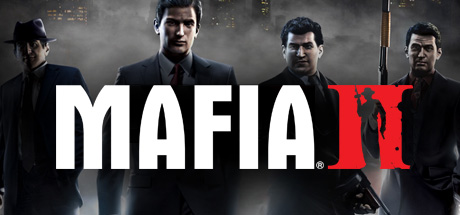

**Mafia II is the acclaimed crime drama following Vito Scaletta and Joe Barbaro's rise through post-war Empire Bay's criminal underworld. Features a tight linear narrative, period-perfect 1940s-50s atmosphere, and one of gaming's best bromance stories.**

---

## 📖 About

Mafia II is the acclaimed crime drama following Vito Scaletta and Joe Barbaro's rise through post-war Empire Bay's criminal underworld. Features a tight linear narrative, period-perfect 1940s-50s atmosphere, and one of gaming's best bromance stories.

## ⚠️ Problems Without Trainer

| Problem | Status |
|---------|--------|
| **Short Campaign** — Main story completable in 8-10 hours with limited replay incentive | ✅ Solved |
| **Speed Limits** — Police respond immediately to speeding creating constant open-world friction | ✅ Solved |
| **Cover Shooting** — Combat is fairly basic compared to contemporaries at release | ✅ Solved |
| **DLC Fragmentation** — Original DLC expansions sold separately | ✅ Solved |

## ✅ Solution

The **Mafia II Trainer** solves all these issues by giving you complete control over the game.

## 🎯 Full Feature List

- Unlimited Resources
- God Mode / Invincibility
- Instant Skill Cooldown
- One-Hit Kill
- Freeze Game Timer
- Unlock All Items & Achievements
- Custom Speed Multiplier
- Save State Anywhere

## 🚀 Quick Start

1. **Disable Windows Defender** temporarily (trainer may trigger false positive)
2. Download the trainer from the button above
3. Launch Mafia II
4. Run the trainer as Administrator
5. Activate desired cheats with hotkeys

## 💎 Free vs Paid

| Feature | Free | Pro |
|---------|------|-----|
| Basic God Mode | ✅ | ✅ |
| Unlimited Resources | ✅ | ✅ |
| All Advanced Cheats | ❌ | ✅ |
| Auto-Updates | ❌ | ✅ |
| Priority Support | ❌ | ✅ |

## 💻 Requirements

- Windows 10/11 (64-bit)
- Mafia II (any version)
- .NET Framework 4.8+
- DirectX 11+

## 🍎 macOS

macOS users can use our alternative tool:

## ⚖️ Legal

This trainer is for educational and single-player use only. Use responsibly.

---

